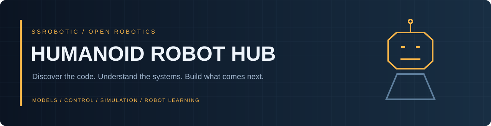

<p align="center"></p>

<p align="center"><b>A curated gateway to humanoid robotics — models, control, simulation and robot learning.</b><br>Created and curated by <a href="https://github.com/SSRobotic">SSRobotic</a> · Robotics Engineer &amp; Open-source Curator</p>

<p align="center"><a href="https://ssrobotic.github.io/humanoid-robot-hub/">Explore the searchable Hub</a> · <a href="#resource-directory">Resource directory</a> · <a href="guides/getting-started.md">Getting started</a> · <a href="CONTRIBUTING.md">Contribute a resource</a></p>


## Why this hub exists

Humanoid robotics resources are spread across hardware vendors, research projects and tool repositories. I created this hub to bring useful starting points together, explain what each resource does and make them easier to explore.

This repository combines **8 existing public SSRobotic collections (1,687 source files)** into one organized library and indexes **12 additional upstream projects**. The website searches this curated catalog by robot, tool, category and source; it does not search all of GitHub live.

ผมสร้าง Hub นี้เพื่อรวบรวมโค้ด โมเดล และเครื่องมือเกี่ยวกับ Humanoid Robotics ไว้ในที่เดียว จัดหมวดหมู่ตามการใช้งาน พร้อมอธิบายบทบาทและให้เครดิตผู้พัฒนาต้นฉบับ ค้นหาได้ทั้งภาษาไทยและอังกฤษ

## Choose your route

| Your goal | Start here |
| --- | --- |
| Inspect a humanoid model | [DOBOT Atom URDF](collections/dobot/atom-urdf) · [Unitree models](collections/unitree/ros/robots) |
| Explore ROS 2 integration | [Unitree ROS 2](collections/unitree/ros2) · [DOBOT Atom ROS 2](collections/dobot/atom-ros2) |
| Find hardware SDKs | [Atom SDK](collections/dobot/atom-sdk) · [Unitree SDK2](https://github.com/unitreerobotics/unitree_sdk2) |
| Start with simulation | [Unitree MuJoCo](https://github.com/unitreerobotics/unitree_mujoco) · [MuJoCo](https://github.com/google-deepmind/mujoco) |
| Explore robot learning | [Isaac Lab](https://github.com/isaac-sim/IsaacLab) · [Unitree RL Gym](https://github.com/unitreerobotics/unitree_rl_gym) · [LeRobot](https://github.com/huggingface/lerobot) |
| Study perception & manipulation | [DOBOT Vision](collections/dobot/ros2-vision) · [Magician ROS](collections/dobot/magician-ros) |

## Resource directory

**Collection** links open source snapshots consolidated here. **Original project** links open the upstream project. Legacy quadruped SDKs, desktop arms and generic frameworks are supporting resources; compatibility is documented by each project.

| Resource | Keywords | What it provides | Original creators / source |
| --- | --- | --- | --- |
| [Unitree ROS 2](https://github.com/SSRobotic/humanoid-robot-hub/tree/main/collections/unitree/ros2) | G1, H1, ROS 2 | ROS 2 / DDS integration; G1 and H1 examples alongside quadrupeds. | [unitreerobotics](https://github.com/unitreerobotics/unitree_ros2) |
| [Unitree ROS & Models](https://github.com/SSRobotic/humanoid-robot-hub/tree/main/collections/unitree/ros) | G1, H1, URDF | Robot descriptions, Gazebo packages and joint controllers; includes G1 / H1 models. | [unitreerobotics](https://github.com/unitreerobotics/unitree_ros) |
| [Unitree Legacy SDK](https://github.com/SSRobotic/humanoid-robot-hub/tree/main/collections/unitree/legacy-sdk) | Go1, Legacy SDK, C++ | Legacy Unitree SDK collection; inspect bundled headers for platform compatibility. Use SDK2 for modern humanoids. | [unitreerobotics](https://github.com/unitreerobotics/unitree_legged_sdk) |
| [DOBOT Atom Models](https://github.com/SSRobotic/humanoid-robot-hub/tree/main/collections/dobot/atom-urdf) | Atom, URDF, Xacro | URDF / Xacro and meshes for Atom visualization and model inspection. | [Dobot-Arm](https://github.com/Dobot-Arm/dobot_atom_urdf) |
| [DOBOT Atom SDK](https://github.com/SSRobotic/humanoid-robot-hub/tree/main/collections/dobot/atom-sdk) | Atom, C++, RPC | C++ SDK with RPC, DDS and joint recording examples. | [Dobot-Arm](https://github.com/Dobot-Arm/dobot_atom_sdk) |
| [DOBOT Atom ROS 2](https://github.com/SSRobotic/humanoid-robot-hub/tree/main/collections/dobot/atom-ros2) | Atom, ROS 2, Gazebo | ROS 2 packages, robot descriptions, simulation and control examples. | [Dobot-Arm](https://github.com/Dobot-Arm/dobot_atom_ros2) |
| [DOBOT Magician ROS](https://github.com/SSRobotic/humanoid-robot-hub/tree/main/collections/dobot/magician-ros) | Magician, ROS Kinetic, Robot arm | Legacy desktop arm ROS demo; supporting manipulation resource, not a humanoid stack. | [Dobot-Arm](https://github.com/Dobot-Arm/Magician_ROS) |
| [DOBOT ROS 2 Vision](https://github.com/SSRobotic/humanoid-robot-hub/tree/main/collections/dobot/ros2-vision) | RealSense, YOLO, ROS 2 | RealSense, hand-eye calibration and recognition / grasp examples for the EG0053-01 workstation. | [Dobot-Arm](https://github.com/Dobot-Arm/dobot_ros2_vision) |
| [Unitree SDK2](https://github.com/unitreerobotics/unitree_sdk2) | G1, H1, C++ | Modern Unitree communication and control SDK. Check examples and firmware requirements for your robot. | [unitreerobotics](https://github.com/unitreerobotics/unitree_sdk2) |
| [Unitree SDK2 Python](https://github.com/unitreerobotics/unitree_sdk2_python) | G1, H1, Python | Python interfaces and examples for Unitree SDK2 workflows. | [unitreerobotics](https://github.com/unitreerobotics/unitree_sdk2_python) |
| [Unitree MuJoCo](https://github.com/unitreerobotics/unitree_mujoco) | G1, H1, MuJoCo | Unitree simulator with C++ / Python implementations and robot MJCF models; focused on low-level controller development. | [unitreerobotics](https://github.com/unitreerobotics/unitree_mujoco) |
| [Unitree RL Gym](https://github.com/unitreerobotics/unitree_rl_gym) | Unitree, RL, Isaac Gym | Reinforcement learning training examples for Unitree locomotion. Use the documented simulator and task versions. | [unitreerobotics](https://github.com/unitreerobotics/unitree_rl_gym) |
| [Isaac Lab](https://github.com/isaac-sim/IsaacLab) | RL, Simulation, Isaac Sim | Framework for robot learning built on Isaac Sim, with environments and training integrations. | [isaac-sim](https://github.com/isaac-sim/IsaacLab) |
| [MuJoCo](https://github.com/google-deepmind/mujoco) | Physics, Python, C++ | Physics simulation engine for robotics and control research. Robot-specific setup comes from model and task repositories. | [google-deepmind](https://github.com/google-deepmind/mujoco) |
| [MuJoCo Menagerie](https://github.com/google-deepmind/mujoco_menagerie) | MJCF, Models, MuJoCo | A collection of robot models for MuJoCo. Inspect individual model folders for hardware coverage and asset licenses. | [google-deepmind](https://github.com/google-deepmind/mujoco_menagerie) |
| [LeRobot](https://github.com/huggingface/lerobot) | Imitation learning, Datasets, Python | Robot learning tools, datasets and policies. A supporting embodied AI resource; hardware support is project-specific. | [huggingface](https://github.com/huggingface/lerobot) |
| [ros2_control](https://github.com/ros-controls/ros2_control) | ROS 2, Controllers, Hardware interfaces | ROS 2 hardware abstraction and controller framework for integrating robot hardware and simulation. | [ros-controls](https://github.com/ros-controls/ros2_control) |
| [Pinocchio](https://github.com/stack-of-tasks/pinocchio) | Kinematics, Dynamics, C++ | Rigid-body dynamics and kinematics algorithms for robotics, including model-based control research. | [stack-of-tasks](https://github.com/stack-of-tasks/pinocchio) |
| [Drake](https://github.com/RobotLocomotion/drake) | Dynamics, Optimization, Planning | Model-based robotics toolbox for dynamics, optimization, planning and control. | [RobotLocomotion](https://github.com/RobotLocomotion/drake) |
| [OpenLoong Dynamics Control](https://github.com/loongOpen/OpenLoong-Dyn-Control) | Humanoid, Whole-body control, MuJoCo | OpenLoong humanoid dynamics and control framework with simulation resources. Follow its supported model and environment. | [loongOpen](https://github.com/loongOpen/OpenLoong-Dyn-Control) |

## Repository structure

```text
collections/
  unitree/             ROS, ROS 2 and legacy Go1 SDK snapshots
  dobot/               Atom models / SDK / ROS 2, Magician and vision
docs/                  Searchable bilingual GitHub Pages directory
guides/                Getting started and collection map
catalog.json           Curated resource data
provenance.json        Original repository, commit and license locations
```

The collections retain their own build instructions and dependency versions. They are independent packages, not a single combined robot controller. Upstream resources are indexed by link rather than copied into this repository.

## About the curator

I'm **SSRobotic**, a **Robotics Engineer & Open-source Curator** focused on bringing robotics resources into a practical, navigable collection. My contribution here is the hub architecture, resource selection, organization, discovery interface and documentation. Original SDKs, robot models and research frameworks belong to their respective creators.

## Sources, credit and licenses

See [CREDITS.md](CREDITS.md) and [provenance.json](provenance.json) for the snapshot map and original sources. Existing notices and license files are retained inside each collection. This hub does not relicense third-party code, models, binaries or datasets. The MIT license at the root applies only to the original hub interface and editorial content, as scoped in [LICENSE](LICENSE).

## Use locally

```bash
git clone https://github.com/SSRobotic/humanoid-robot-hub.git
cd humanoid-robot-hub
python -m http.server 8000 --directory docs
```

Open `http://localhost:8000`. No build step or API key is required. Read the [getting-started guide](guides/getting-started.md) before choosing a collection's installation steps.

## Contribute

Suggest a resource through [GitHub Issues](https://github.com/SSRobotic/humanoid-robot-hub/issues/new/choose). Include its original source, intended use, supported hardware and license. See [CONTRIBUTING.md](CONTRIBUTING.md).
